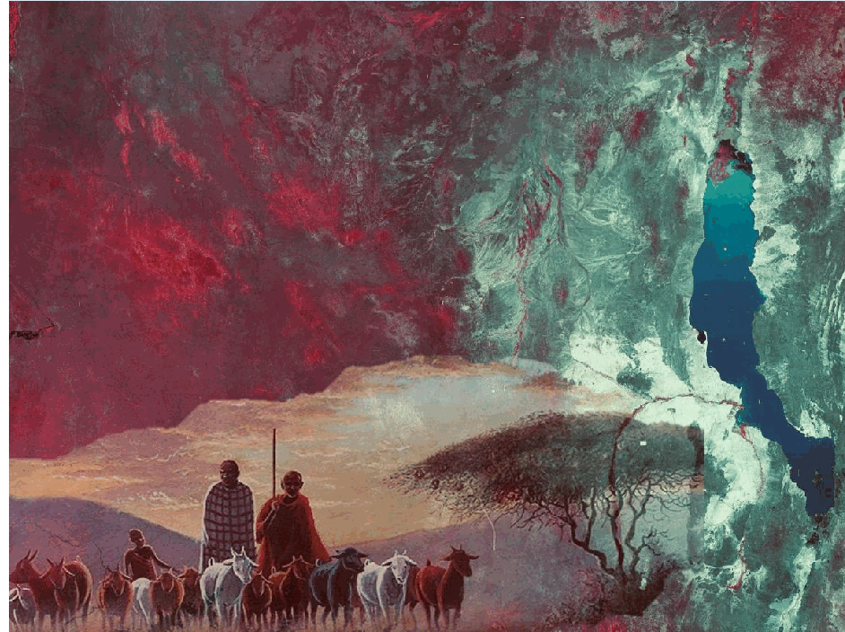
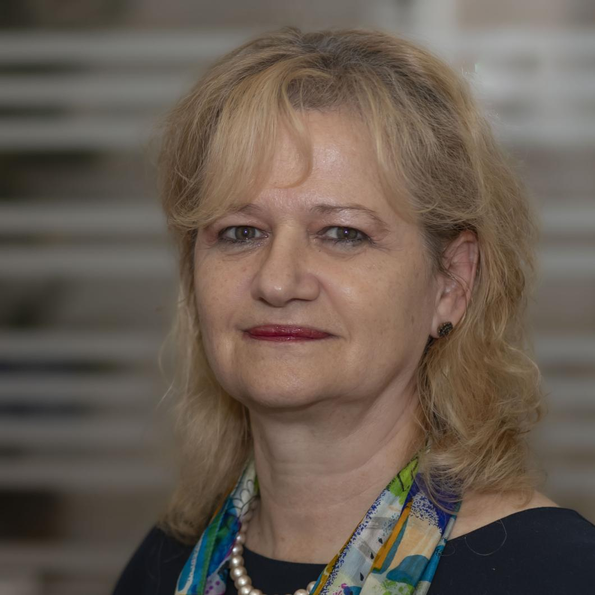
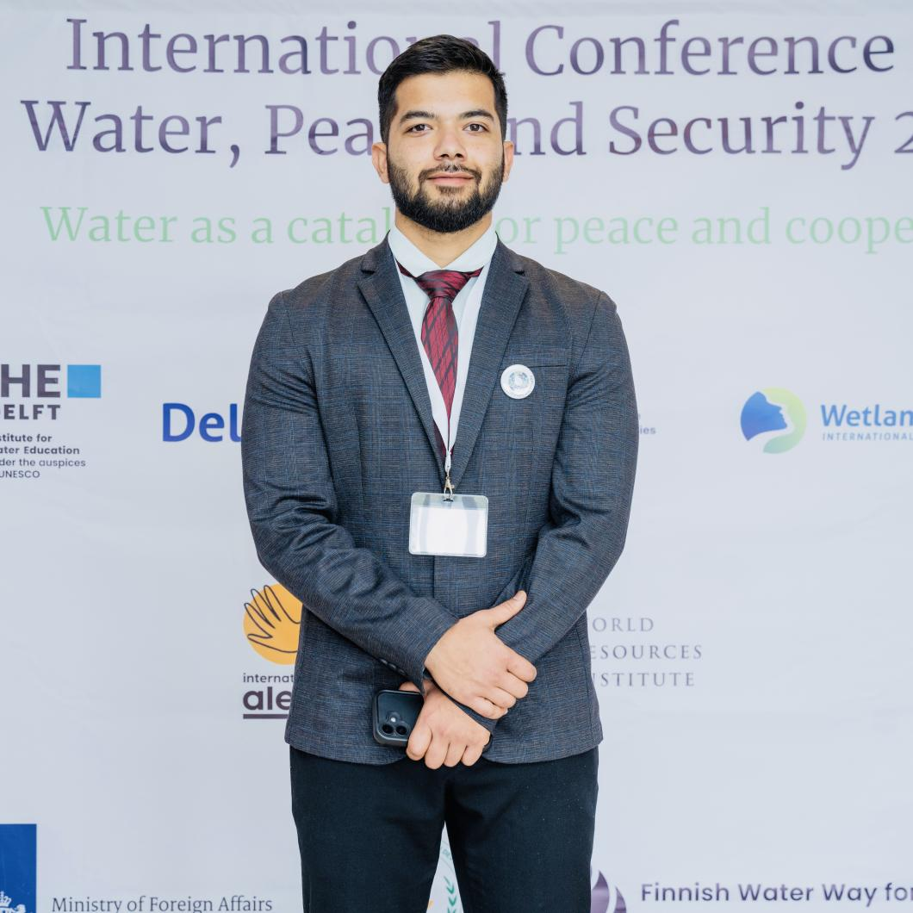

# Rainfall and Vegetation Response in North Turkana

Mini-project 3 · Lake Turkana teaching resources

### Course authors

Ioana Popescu and Krishna Arun Patil

*Cover artwork from Krishna Arun Patil’s 2023 MSc thesis.*

## Course sections

1. [Start here](Student/00_Start_Here.md)
2. [What is NDVI?](Student/01_What_is_NDVI.md)
3. [Entry check](Student/02_Entry_Check.md)
4. [Earth Engine setup and script walkthrough](Student/Background_and_script_walkthrough.md)
5. [Interactive map activity](Student/Background_and_script_walkthrough.md#optional-interactive-map)
6. [Colab practical](Student/Turkana_NDVI_Lag.ipynb)
7. [Word practical and submission requirements](Student/NDVI_Student_Guide.docx)

To run the Python practical, open the notebook in Colab through **File → Open notebook → GitHub** or download the notebook and choose **Upload**. Use your own Google credentials and an Earth Engine enabled project.

The JavaScript and workbook provide a second route through the same lab. See the [instructor pilot and assessment notes](Instructor/Pilot_and_assessment.md) for steps to verify the site, run the live export and capture screenshots.
