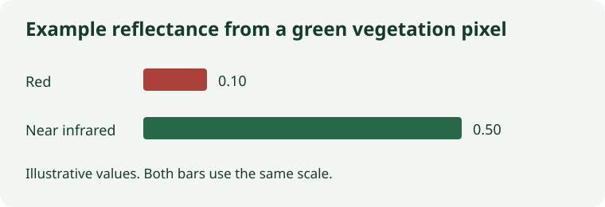

# What is NDVI?

**Learning objective:** Explain what NDVI measures, calculate it from two reflectance values and describe why a low reading needs context.

## From reflected light to greenness

NDVI stands for **Normalized Difference Vegetation Index**. It compares red and near-infrared (NIR) reflectance measured by a satellite. Chlorophyll absorbs much of the red light, while the internal structure of green leaves reflects near-infrared light. The stronger this contrast, the higher the NDVI. The index is unitless and its theoretical range is −1 to +1. [NASA Earth Observatory](https://earthobservatory.nasa.gov/Features/MeasuringVegetation/measuring_vegetation_2.php)

**NDVI = (NIR − Red) / (NIR + Red)**

With NIR = 0.50 and Red = 0.10, NDVI = (0.50 − 0.10) / (0.50 + 0.10) = **0.67** (rounded). A low NDVI value can occur over bare soil, sparse vegetation or water. Check the land cover, observation quality and typical seasonal conditions before interpreting it as stress.

## Why we use it in North Turkana

A single NDVI image shows how greenness varies across the landscape on a given date or compositing period. A time series lets us compare the timing of vegetation changes with rainfall. This practical uses monthly CHIRPS rainfall and MODIS NDVI to test for a delayed response at a rangeland site.

## Watch the NDVI overview

Watch the introductory NDVI discussion in **NASA ARSET: NDVI & QGIS, Part 1**. You can stop when the video moves into the QGIS demonstration. As you watch, listen for why plants respond differently in red and near-infrared wavelengths.

Next: [02 Entry check](02_Entry_Check.md)
